# Task B2 – Engineer Adversarial Inputs (5 marks, K4)

Compiler: GCC 13.3.0, Valgrind 3.22.0, AddressSanitizer (`-fsanitize=address`). Programs are built with
`-std=c11 -Wall -Wextra -O0 -g` and compile without warnings (except the deliberately buggy
`b2_memerr_buggy.c`, where GCC itself warns about the bugs). All output below is verbatim from `run_b2.sh`
(`evidence/*.txt`, PNG captures in `screenshots/`).

| File | Purpose |
|---|---|
| `b2_scanf_unsafe.c` | name read with `scanf("%s")` – deliberately unsafe |
| `b2_fgets_safe.c` | same input read with `fgets` – safe |
| `b2_bloodbank.c` | CLI program: `find`, `register`, `issue`; every error path reports through `perror()` / `fprintf(stderr)` |
| `b2_memerr_buggy.c` / `b2_memerr_fixed.c` | four classic memory errors, then their fixes |
| `b2_getline_alt.c` | alternative concept: `getline()` |
| `data/donors.txt`, `data/stock.txt`, `data/donors_bad.txt` | input files (the last one is deliberately damaged) |
| `run_b2.sh` | rebuilds and re-runs every experiment |

---

## 1. Over-long donor name: `scanf("%s")` versus `fgets` (≈ 1.5 marks)

`struct { char name[10]; int age; }` – the array holds 9 characters + NUL; `age` is set to 25 before the read.

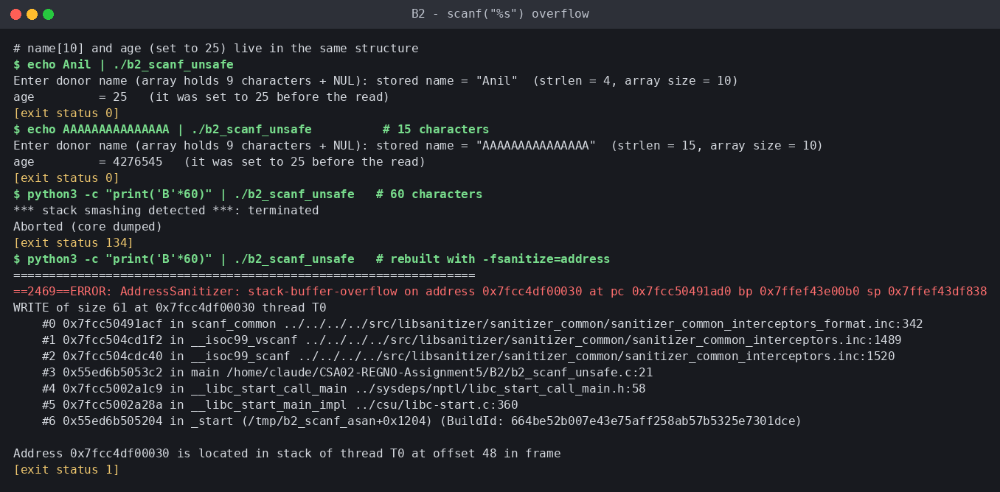

| Input | Observed with `scanf("%s")` | Explanation |
|---|---|---|
| `Anil` (4 chars) | name = Anil, age = 25 | fits – works |
| 15 × `A` | name = `AAAAAAAAAAAAAAA`, **age = 4 276 545** | `%s` has no width limit, so it keeps writing past `name[9]`; bytes 12–14 are `'A'` (0x41) and byte 15 is the NUL, which overwrites the low bytes of `age`: 0x00414141 = 4 276 545. **Silent data corruption – no crash, no message.** |
| 60 × `B` | `*** stack smashing detected ***: terminated`, exit 134 (SIGABRT) | the write reaches the stack canary and the saved registers; the runtime aborts the program when `main` returns. Without the canary this is the classic return-address overwrite (security hole). |
| 60 × `B`, built with `-fsanitize=address` | `stack-buffer-overflow … WRITE of size 61` at `b2_scanf_unsafe.c:21` | AddressSanitizer pinpoints the exact line and the size (60 chars + NUL = 61) |

**Fix – `fgets` with the real array size** (`b2_fgets_safe.c`):

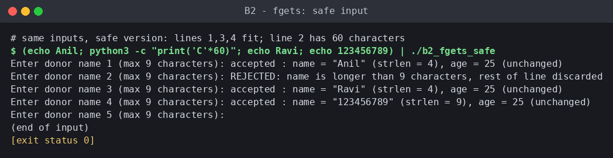

`fgets(buf, sizeof buf, stdin)` never writes more than `sizeof buf` bytes. If the buffer contains no `'\n'` the
line did not fit, so the program (1) reports *name too long*, (2) discards the rest of the line so the **next**
read starts at the next line (donor 3 `Ravi` is read correctly after the 60-character line), and (3) leaves `age`
untouched (still 25). The edge case "exactly 9 characters" (`123456789`) is accepted – verified.
(`scanf("%9s", name)` would also be safe, but silently splits long input into pieces left in the buffer.)

## 2. Missing or read-only data file – `perror()` instead of a crash (≈ 1 mark)

Every `fopen` result in `b2_bloodbank.c` is tested; on `NULL` the program calls `perror(path)` and returns exit status 1.

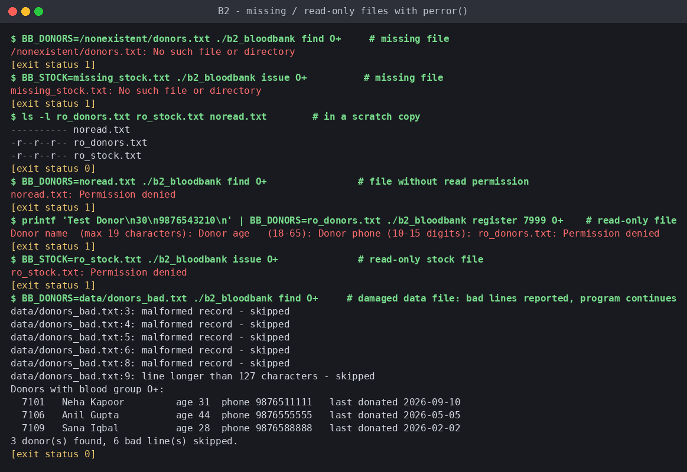

| Situation | Message printed | Exit |
|---|---|---|
| `find` – data file does not exist | `/nonexistent/donors.txt: No such file or directory` | 1 |
| `issue` – stock file does not exist | `missing_stock.txt: No such file or directory` | 1 |
| `find` – file without read permission (`chmod 000`) | `noread.txt: Permission denied` | 1 |
| `register` – donors file read-only (`chmod 444`) | `ro_donors.txt: Permission denied` – nothing is written | 1 |
| `issue` – stock file read-only | `ro_stock.txt: Permission denied` – file unchanged | 1 |
| `find` – damaged file (`donors_bad.txt`) | six lines reported with their line numbers and skipped; the 3 valid O+ donors are still listed | 0 |

*Without* the check, `fgets(…, NULL)` / `fprintf(NULL, …)` would dereference a null pointer and crash with SIGSEGV.
(The read-only tests are run as an ordinary user, because the root account ignores file permissions.)
The damaged-file test also shows over-long lines (> 127 characters) being rejected without overflowing the line buffer,
a wrong group (`Z+`), an age of 7, a name longer than 19 characters, a missing field and a surplus field – all
caught by width-limited `sscanf` formats and range checks.

## 3. Wrong command-line arguments (≈ 1 mark)

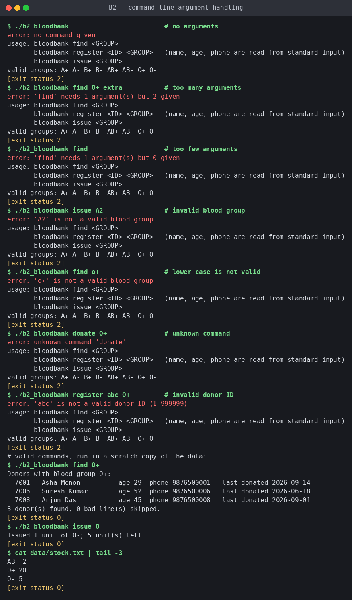

| Command | Handling | Exit |
|---|---|---|
| `bloodbank` (none) | `error: no command given` + usage | 2 |
| `bloodbank find O+ extra` (too many) | `'find' needs 1 argument(s) but 2 given` + usage | 2 |
| `bloodbank find` (too few) | `'find' needs 1 argument(s) but 0 given` | 2 |
| `bloodbank issue A2` (invalid group – the example from the assignment) | `'A2' is not a valid blood group` | 2 |
| `bloodbank find o+` (lower case) | rejected – group names are matched exactly against the eight valid names | 2 |
| `bloodbank donate O+` | `unknown command 'donate'` | 2 |
| `bloodbank register abc O+` | `'abc' is not a valid donor ID (1-999999)` (checked with `strtol` + end-pointer + range) | 2 |
| `bloodbank find O+`, `bloodbank issue O-` | normal operation (run on a scratch copy; stock O- 6 → 5) | 0 |

`argc` is checked before any `argv[i]` is touched, so the program never reads a missing argument. Usage errors
use exit status 2, runtime/file errors status 1, so scripts can tell them apart.

Adversarial *interactive* input to `register` (name, age, phone are read with the safe `read_line`):

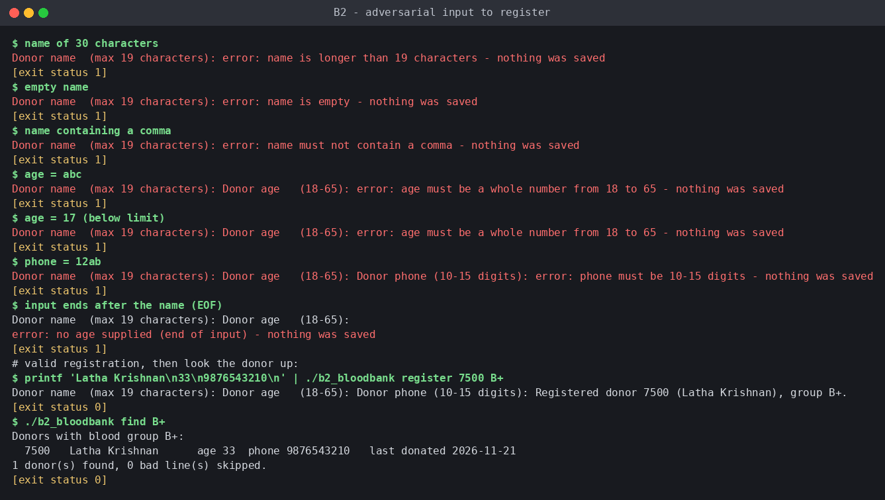

A 30-character name, an empty name, a comma in the name (would corrupt the comma-separated file), age `abc`,
age 17, phone `12ab` and end-of-input in the middle of the dialogue are **all rejected with "nothing was saved"**; a
valid donor is saved and then found by `find B+`.

## 4. Valgrind and AddressSanitizer (≈ 1.5 marks)

`b2_memerr_buggy.c` contains four bugs (run one at a time with a mode argument). GCC already warns about three of
them at compile time (`-Wstringop-overflow`, `-Wuse-after-free`), and the runtime tools classify all four:

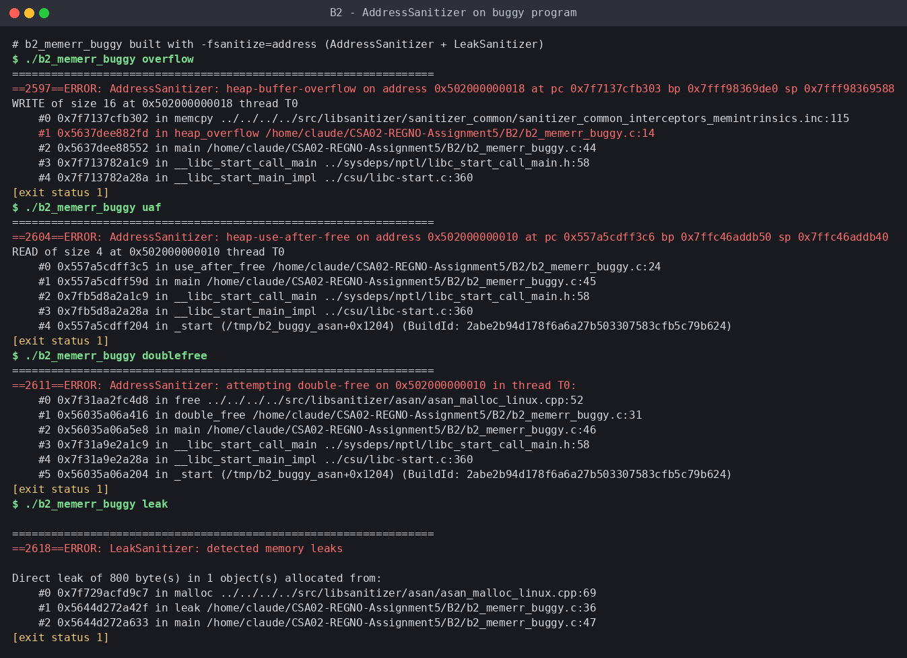
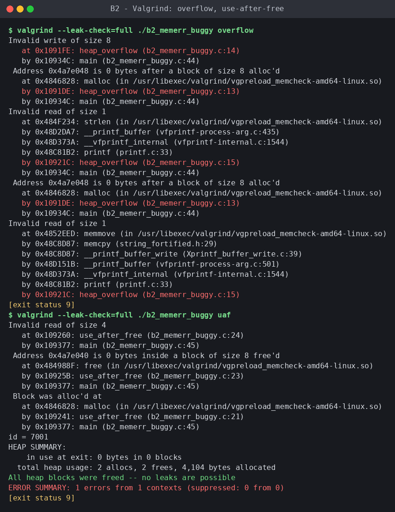
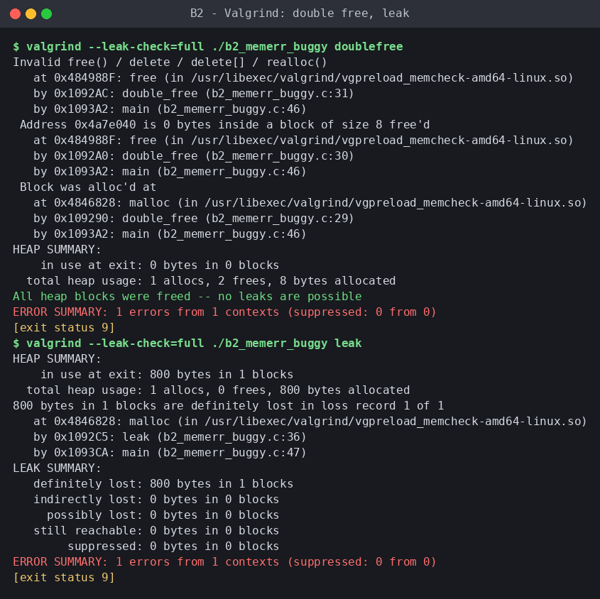

| Bug | Code | AddressSanitizer | Valgrind | Fix in `b2_memerr_fixed.c` |
|---|---|---|---|---|
| Heap buffer overflow | `malloc(8)` then `strcpy` of 16 bytes | `heap-buffer-overflow … WRITE of size 16` (line 14) | `Invalid write of size 8 … 0 bytes after a block of size 8` | allocate `strlen(src)+1` |
| Use after free (dangling pointer) | read `d->id` after `free(d)` | `heap-use-after-free … READ of size 4` | `Invalid read of size 4 … inside a block of size 8 free'd` | use data before freeing; `d = NULL` after `free` |
| Double free | `free(d); free(d);` | `attempting double-free` | `Invalid free() … free'd` | set `d = NULL` after the first free (`free(NULL)` is a no-op) |
| Memory leak | last pointer overwritten with `NULL` before `free` | `LeakSanitizer: Direct leak of 800 byte(s)` | `800 bytes in 1 blocks are definitely lost` | `free(list)` before the pointer goes out of scope |

After the corrections **both tools report nothing**:

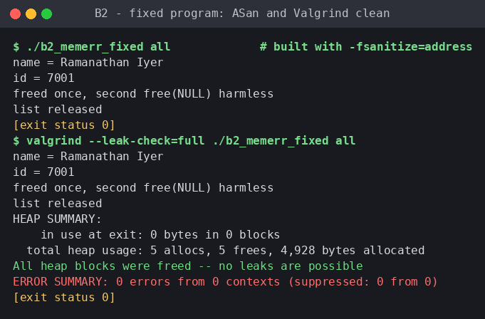

(`All heap blocks were freed -- no leaks are possible`, `ERROR SUMMARY: 0 errors`.)

The real program `b2_bloodbank` was then run under both tools with six scenarios (normal find, damaged file,
issue, register, invalid group, missing file): AddressSanitizer printed no report, and Valgrind exit status was 0 for
every scenario that ran to completion (the program's own error exits 1 and 2 are passed through; Valgrind's
`--error-exitcode=9` never appeared). The summary for `find O+`: 3 allocs, 3 frees, 0 bytes in use at exit
(the program itself uses only fixed-size arrays; the allocations belong to the C library).

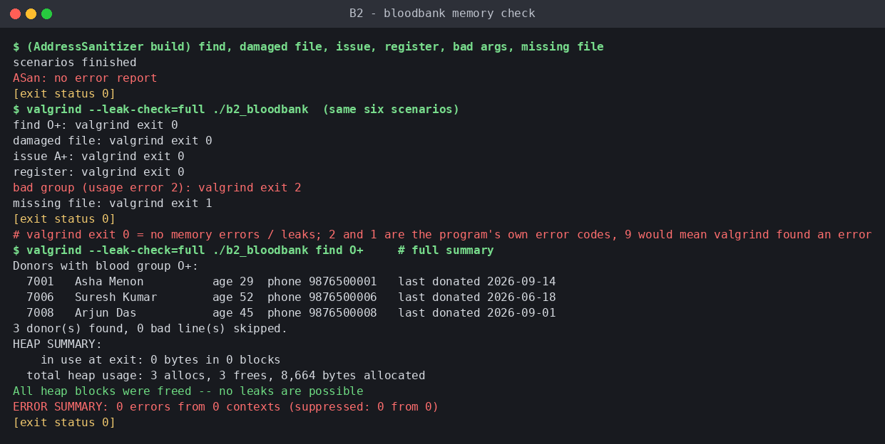

**Errors found and fixed in this task:** (a) `scanf("%s")` buffer overflow → `fgets` with `sizeof` + truncation
detection; (b) unchecked `fopen` → `perror` + error return; (c) unchecked `argc`/`argv` → validation with usage
messages; (d) the four heap errors above → corrected versions. The `read_line` helper also handles the boundary case "line exactly fills the buffer" without wrongly rejecting it
(tested with the 9-character name in `b2_fgets_safe`).

---

## Alternative concept – `getline()` instead of `fgets()` into a fixed array

```c
char *line = NULL; size_t cap = 0; ssize_t len;
while ((len = getline(&line, &cap, stdin)) != -1) {
    /* line holds the whole line, cap is the allocated size */
}
free(line);                      /* the CALLER must free it */
```

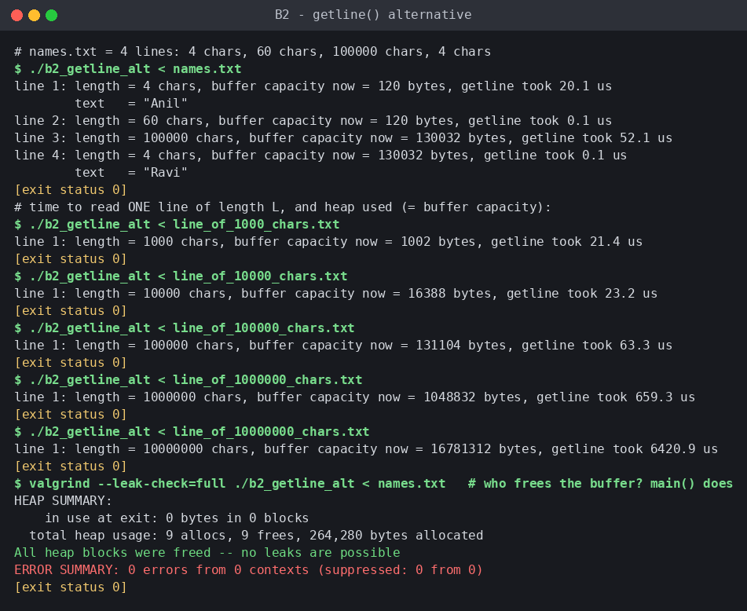

`getline` allocates (and `realloc`s when a longer line arrives) a buffer big enough for the **whole** line, so there
is no truncation and no overflow: the 100 000-character line was read completely (buffer grew from 120 to ≈ 130 KB) and
the buffer was *reused* for the following short line.

| Line length L | Buffer capacity after reading | Time to read the line |
|---:|---:|---:|
| 1 000 | 1 002 bytes | ≈ 21 µs (includes one-time start-up cost) |
| 10 000 | 16 388 bytes | ≈ 23 µs |
| 100 000 | 131 104 bytes | ≈ 63 µs |
| 1 000 000 | 1 048 832 bytes | ≈ 0.66 ms |
| 10 000 000 | 16 781 312 bytes | ≈ 6.4 ms |

* **Time:** O(L) – the line is scanned once; growth by `realloc` is geometric so the amortised copying is O(L) too
  (measurements: ×10 in L gives roughly ×10 in time for large L). `fgets` into a fixed array is also O(L) per line,
  but it cannot keep the whole line when L exceeds the array.
* **Heap space:** O(L) (between L+1 and about 2L bytes for the longest line seen); the fixed array is O(1) stack space
  (e.g. 128 bytes) but can only hold a bounded line.
* **Who frees:** the **caller** – exactly one `free(line)` after the loop, even at end-of-file, because `getline`
  allocates a buffer even when it returns −1. Forgetting it is a leak; Valgrind confirms the program above frees every
  block (`9 allocs, 9 frees`, `ERROR SUMMARY: 0 errors`).
* **Risk:** an attacker can send an unbounded line and make the program allocate gigabytes (memory exhaustion), so
  `getline` input still needs an upper limit for untrusted data; `getline` is POSIX (not standard C11) and needs
  `_POSIX_C_SOURCE 200809L`.

**Recommendation.** For fields with a known maximum (names, group codes, phone numbers) use `fgets` into a fixed
array with truncation detection – predictable memory, no allocation failure, no leak possible. Use `getline` for
free-form text of unknown length, together with a maximum-length check and a single `free`. Never use `scanf("%s")`
without a width, and always test `fopen` results and `argc`.
